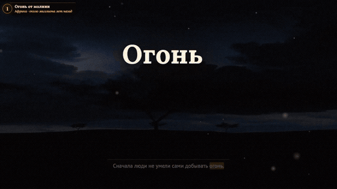
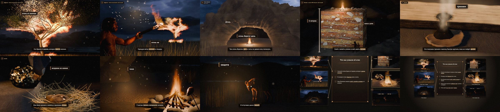
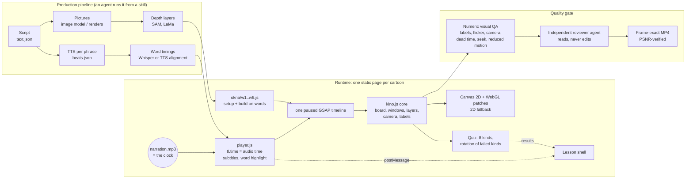
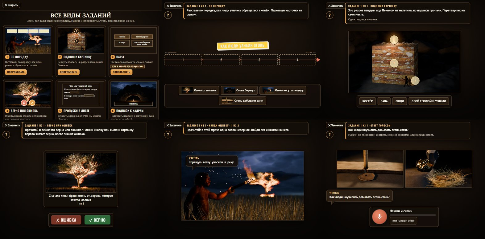

# Lesson-to-Cartoon Engine

**A lesson text goes in, a 1-2 minute narrated cartoon comes out: 6-8 picture "windows", a camera and effects keyed to
the words of the narration, word-highlighted subtitles, WebGL effects with a 2D fallback, and a quiz of 8 task kinds
that brings back what the child got wrong. Every frame is a pure function of audio time, so seeking, rewinding and a
frame-by-frame video export all show the same picture, and that is what lets a numeric QA suite measure the cartoon
instead of a person watching it. I built the engine and the agent-operated production pipeline for an AI-first EdTech
platform for school lessons, live in production; this repository is the standalone version with an original demo.**



*The demo "Огонь" (Fire), 80 s: Blender renders of my own 3D clip, narration with word-synced subtitles and captions.
[Watch the first 24 s with sound](docs/media/fire-first-24s.mp4) · [open the demo](demo/) after `npm run serve`.*

| | |
|---|---|
| **What** | Scene engine + player + quiz bank + numeric visual QA + an agent-operated production pipeline |
| **In production** | 9 cartoons shipped on the platform: 4 in a school history lesson, 5 in a school biology lesson |
| **Per cartoon** | <= ~2 min, 6-8 windows; ~3,000 TTS characters with the quiz lines; usually <= 40 image credits |
| **Pipeline** | 8 stages: script, voice, pictures and layers, scene, quiz, acceptance + independent reviewer agent, video, port into the lesson |
| **QA on the demo** | 27 green / 0 red at 4 viewports; seek gives identical frames; quiz walk passes (measured on 2026-11-20 in this repo) |
| **Stack** | Vanilla JS, GSAP, Canvas 2D, WebGL, Web Audio, Playwright, sharp, ffmpeg; Python: faster-whisper, numpy/scipy, Depth-Anything-V2, SAM, LaMa; ElevenLabs TTS; Higgsfield (Nano Banana Pro) images |
| **Runs** | from any static server, no keys, no build step |

The lesson content is in Russian; code, comments and docs are in English.



## How it works



1. **The narration is the clock.** The scene builds one paused GSAP timeline; on every animation frame the player sets
   it to the audio's current time (through a smoothed clock that never drifts more than 30-50 ms from the audio).
   Nothing in the scene runs on its own timers.
2. **Everything is keyed to words.** Windows place captions, camera moves and their one strong effect with
   `k.wordAt('S6', 'дымок')`, using word timings recognised from the track itself. Re-voice a phrase and the cartoon
   follows.
3. **Windows are small programs.** Each window file lays out its layers once (`setup`) and adds its piece of the timeline
   (`build`). The core gives them a camera (pans between pinned ends, van Wijk arcs between windows, cuts under flashes),
   canvas and DOM labels, painters, masks, water, flocks and WebGL patches.
4. **After the cartoon** comes a board the child can fly over, a "what we learned" sheet, and the quiz. Results go to the
   lesson shell by postMessage.

## Engineering decisions

- **Audio time as the single source of truth.** Background life (embers, dust, flicker) is a pure function of page time,
  events are tweens of one timeline, `setTimeout` and accumulated state are banned in scene code (core and windows).
  The payoff is huge: `?t=31` opens any frame, seeking backwards is free, the video exporter is just "seek, screenshot,
  repeat", and QA can compare the same frame reached three different ways (jump from 0, jump back, step forward) to the
  pixel.
- **Measure the cartoon, then let an independent agent judge it.** Scripts measure what is measurable (labels out of
  frame, flicker, camera speed and jerk, dead stretches, effect rules, seek determinism, video PSNR). They cannot see
  meaning, so a separate reviewer agent that only reads and reports checks text against the sources and snapshots
  through the eyes of a 10-year-old. On its first review it found a factual blocker in every cartoon, which is why it
  became a mandatory gate.
- **Rules enforced in code, not in a style guide.** The core warns when a window breaks a rule: a fourth shake or flash,
  a camera move that starts before the last one ends, a label that leaves before it finished appearing, a drift faster
  than 0.6 px/frame, more than 2 WebGL patches in frame. The QA suite turns the same rules into red lines.
- **Canvas labels where DOM labels jitter.** DOM text on a slow camera drift snaps to whole pixels and visibly shakes
  (a probe measures it). Captions that stay in frame while the camera moves are drawn on the window canvas and move with
  the picture pixel for pixel; DOM copies exist only for the board.
- **WebGL as a patch, never as the renderer.** A shader computes only a rectangle of the picture and is laid over the 2D
  frame with a soft mask; without WebGL, in reduced motion or on a slow machine (median frame > 22 ms) the picture simply
  stays. Textures are uploaded during a still, not on the key word. At most 2 patches in frame.
- **The quiz remembers.** 8 task kinds; each result (ok / help / again) is stored per kind, and the next set starts with
  the kinds that went wrong. `qa/quiz-walk.mjs` proves it by solving the quiz through the UI twice.
- **No keys, static hosting.** The demo needs only a static server: cached narration, word timings and pictures. The
  quiz needs no keys: voice answers use the browser's speech recognition (online in Chrome) and a local keyword judge;
  typed answers work fully offline. The server judge (speech recognition + an LLM rubric) plugs in through
  `window.QUIZ_API`.
- **Copyright as a check, not a promise.** Lesson text is written from facts in our own words, and every narration,
  subtitle and quiz line is scanned against the source texts: no run of 8 identical words may be shared
  (`pipeline/text/overlap_check.py`; on this repository the longest shared run is 6 words).

## Visual QA

Full run on the demo at 4 viewports (measured on 2026-11-20 in this repo; full output in
[`qa/results/fire/summary.txt`](qa/results/fire/summary.txt), thresholds and notes in [`docs/QA.md`](docs/QA.md)):

| Check | Result |
|---|---|
| Seeking gives the same frame (jump from 0, jump back, frame by frame) | identical frames (PSNR 99 dB; threshold 60) |
| Labels in frame, not on the subtitle, not overlapping, not hanging (4 sizes) | 11 labels, 0 remarks |
| Label flicker | 0 |
| Camera: flight speed / jerk / overlaps / time standing still | 15.5 px/frame (<= 30) / 0.54 (<= 0.7) / none / 36.4 % (<= 40 %) |
| Dead stretches >= 2.5 s while the voice speaks | none |
| Strong effects on their word, one per phrase, shakes and flashes <= 3 | 4 effects, 0 shakes, 2 flashes, no violations |
| Reduced motion, console, 404s, the board at 4 sizes | clean |
| Video export vs fresh seeks | 38.7-39.3 dB (>= 30), frame numbers match; 80 s at 1280x720 rendered in 163 s |
| Quiz walk: right answers / planned mistakes | 8 of 8 kinds ok / failed kinds come back first |

In production the same suite gated the platform's cartoons (biology scenes 27 green / 0 red each; two history "epic"
scenes 25 / 2, the 2 red being intentional whip pans), and in one history cartoon the music bus sat 24 dB under the
voice, moving its median intelligibility from 20 to 38 dB.



## Run it

```bash
npm install                      # gsap, playwright, sharp
npm run serve                    # http://localhost:41300/demo/  (host page with the postMessage log)
                                 # http://localhost:41300/demo/fire/index.html  (the cartoon alone)
npm test                         # data consistency + alignment parser (no browser)
```

QA, the quiz walk and the video need a Chromium: either `npx playwright install chromium`, or use an installed Chrome
with `PW_CHANNEL=chrome`:

```bash
PW_CHANNEL=chrome npm run qa:fast   # 735x587 only, ~2 min
PW_CHANNEL=chrome npm run qa        # 3 viewports (+ --plus815 for 4)
PW_CHANNEL=chrome npm run walk      # solve the quiz through the UI, right and with mistakes
PW_CHANNEL=chrome npm run video     # frame-exact MP4 with PSNR verification (ffmpeg on PATH)
```

Producing a new cartoon needs keys and a GPU (see [`.env.example`](.env.example), [`docs/PIPELINE.md`](docs/PIPELINE.md)
and the agent skill template [`skill/SKILL.md`](skill/SKILL.md)). Python tools: `pip install -r pipeline/requirements.txt`.

## Repository layout

```
engine/       player.js (audio clock, subtitles, transport, postMessage), kino.js (the core), fxgl.js (WebGL patches),
              effekty*.js (painters: 2D, film, epic), kit-epik.js (photo-window helpers), rng.js, CSS, lesson stings
quiz/         proverki-kit.js (quiz frame, local keyword judge), proverka-bank.js (8 kinds + rotation), CSS
demo/         index.html (host page: iframe + postMessage log); fire/ (the demo scene: page, theme, okna/w1..w6 + itog,
              art/ pictures and quiz panels, narration.mp3, beats/words/text JSON, quiz-fire.js)
qa/           kino-priemka.mjs (acceptance in one command) and the kino-* measurement scripts, kino-video.mjs (MP4 export),
              quiz-walk.mjs, serve.mjs, tests/, results/fire (the full run on the demo)
pipeline/     narration/ (TTS per phrase with alignment, Whisper word timings, pause shift), audio/ (music synth, mix),
              frames/ (renders to windows, quiz panels), layers/ (depth, SAM masks, LaMa fill, cut-outs),
              text/overlap_check.py
docs/         PIPELINE.md, ENGINE_API.md, QA.md, RELEASE_ASSETS.md, media/
skill/        SKILL.md: a reusable agent skill template for producing a cartoon
```

## Status

- The engine core, effects, WebGL patches, quiz bank, QA scripts and pipeline tools are my production code, extracted
  from the platform and generalised (scene config instead of hard-coded windows, keyless quiz mode, English output).
  The player is a restructured port of my own player code (audio clock, word-highlight subtitles, phrase paging,
  grouped dots, postMessage protocol); the teammate's later extensions for his lessons are not included. A teammate
  built the lesson shell, the realtime voice loop and CI/CD; none of that is here.
- The demo was built for this repository from my own 3D clip; its narration was written from facts for the clip.
  It uses flat renders with cross-fades: the depth-layer tools are included but were not run on the demo.
- The voice answer judge here is the local keyword judge (speech is recognised by the browser, online in Chrome); the
  production server judge is not part of the repository.
- Not deployed anywhere from this repository; every page works from a static server and is GitHub Pages-ready.

## Credits and licenses

- Code: MIT (see [LICENSE](LICENSE)).
- Window pictures of the demo: Blender renders of my 3D clip; the painted cards in it (the man, the hyena, the sky,
  the people) are AI-generated with Higgsfield (Nano Banana Pro).
- Voice: ElevenLabs. Music: synthesised in code (`pipeline/audio/music_fire.py`). Lesson stings (`engine/sound/`):
  synthesised in code by me.
- [GSAP](https://gsap.com) (Standard "no charge" license), loaded from cdnjs with an npm fallback, not vendored.
- Fonts: Lora, PT Sans, PT Serif, Oswald from Google Fonts (SIL Open Font License), loaded from Google Fonts.
- Used by the tools, not included: [faster-whisper](https://github.com/SYSTRAN/faster-whisper) (MIT),
  [Depth-Anything-V2](https://github.com/DepthAnything/Depth-Anything-V2) (code Apache-2.0; the Large weights used by
  `pipeline/layers/depth.py` are CC-BY-NC-4.0, non-commercial), [SAM](https://github.com/facebookresearch/segment-anything)
  (Apache-2.0), [LaMa](https://github.com/advimman/lama) via simple-lama-inpainting, [Playwright](https://playwright.dev)
  (Apache-2.0), [sharp](https://sharp.pixelplumbing.com) (Apache-2.0), ffmpeg,
  [PyMuPDF](https://pymupdf.readthedocs.io) (AGPL-3.0), used by `pipeline/text/overlap_check.py`.

Code was written AI-first with Claude Code; architecture, decisions and acceptance are mine.

## License

MIT
