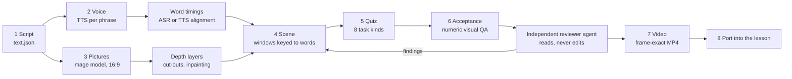

# Production pipeline: lesson text to a narrated cartoon

This is how one cartoon was produced for the platform, step by step, as an AI agent (Claude Code) runs it from a
packaged skill (see [`skill/SKILL.md`](../skill/SKILL.md) for a reusable template). The agent does the work; a person
approves the script, the pictures, the cost and the final review. The steps below name the tools of this repository.

## The rules that shape everything

- **One cartoon is short:** at most about two minutes, built from 6 to 8 "windows" (one picture-world each). A longer
  passage becomes several cartoons in a row.
- **Every frame is a function of audio time.** Events are tweens of one paused timeline; background life (embers,
  dust, water) is a pure function of page time. Nothing accumulates between frames, so seeking backwards or forwards,
  `?t=31` and a frame-by-frame video export all produce the same picture.
- **Captions land on their word.** Labels and strong effects are placed by word timings, not by seconds typed by hand,
  so a re-voiced track moves the whole cartoon with it.
- **One strong effect per phrase**, on its key word (inside -0.3...+0.5 s of the word, never in the first 0.5 s of a
  phrase); at most 3 camera shakes and 3 full-frame flashes per cartoon; at most 2 WebGL patches in frame.
- **The camera keeps moving** (still at most ~40 % of the time), never faster than 30 px per frame on a flight, no
  overlapping moves, no zoom while small labels are in frame (zoom makes DOM letters jitter).
- **Same-voice rule:** the recorded narration and the tutor's live replies use the same voice, model and settings.
- **Copyright:** the scene shows facts in our own words. Every narration, subtitle, caption and quiz line passes an
  overlap check against the source texts: no run of 8 identical words (`pipeline/text/overlap_check.py`).

## 1. Script

`text.json`: one entry per phrase, `{id, show, say, after}`. `show` is the subtitle, `say` is how to read it (numbers in
words, `+` after a stressed vowel), `after` is the pause after the phrase (2.0-2.4 s at a window junction). Next to it the
agent writes a storyboard: 6-8 windows, the picture brief of each, which phrases sound in it, captions, the one strong
effect, the moving objects, the transition between windows, the chapter inset ("No. · title · where/when") and the
"what we learned" sheet. Frames are composed for the narrow lesson column: everything that matters stays above ~70 % of
the picture height, the subtitle lives below.

## 2. Voice and word timings

- `pipeline/narration/ozvuchka-11labs.mjs`: every phrase is synthesised on its own and cached by a hash of
  (voice, model, settings, text), so changing one phrase re-buys only that phrase. Phrases are joined with the pauses of
  the script; `beats.json` (phrase start/end) and `words.json` (from the service's character alignment) are written.
  A cartoon with its quiz lines is about 3,000 characters of TTS.
- `pipeline/narration/slova.py`: word timings by recognising the finished track with faster-whisper (large-v3, GPU).
  Measured in this repo on the demo track: Whisper word starts land on average 0.16 s earlier than the TTS character
  alignment (92 words, mean |difference| 159 ms, 90th percentile 250 ms), which is why the player starts highlighting a
  word 0.05 s early and effects are allowed a -0.3 s lead.
- `pipeline/narration/pauzy-slova.mjs`: when only the pauses change, shift the old word timings instead of recognising
  the voice again.
- `pipeline/audio/mix_narration.py`: voice + music bed. The music sits 24 dB under the voice while someone speaks and
  comes up 8 dB in the pauses; the script reports the voice-to-music ratio per phrase (intelligibility).

## 3. Pictures, layers and motion

- Window pictures: an image model (Nano Banana Pro through Higgsfield), 16:9, 2000x1116. A cartoon usually stays within
  about 40 image credits. Every picture is checked by eye for anachronisms, generator letters and anatomy, and fixed
  by a local edit, not a full regeneration. For the demo in this repository the pictures are Blender renders of the
  author's own 3D clip (`pipeline/frames/frames_to_windows.py`).
- Layers: `pipeline/layers/depth.py` (Depth-Anything-V2 depth map), `sam_mask.py` (object masks from a box and points),
  `lama_fill.py` (fill the hole a cut-out leaves), `cutout.py` (cut objects off a flat grey sheet). Far, middle and near
  layers get a depth `d`, and the camera's parallax separates them.
- Quiz panels are cut from the window pictures (`pipeline/frames/make_panels.py`). Fixed a picture? Re-cut the panels,
  or the quiz keeps the old mistake.

## 4. Scene

A scene page loads the engine (`engine/`), its config `window.KINO` (windows, board, theme, player flags) and one file
per window (`okna/w1.js ... itog.js`) written against the window API ([`ENGINE_API.md`](ENGINE_API.md)). Each window
lays out its layers once (`setup`) and adds its piece of the timeline (`build`), keyed to word timings.

## 5. Quiz after the cartoon

A bank of 8 task kinds: order, label a picture or a map, pairs, true or a mistake, blanks in the sheet, captions for
frames, find the mistake in a phrase, answer in your own words. Sets of 4 rotate like Duolingo: kinds the child got
wrong come back first. Results go to the lesson shell by postMessage. Voice answers are judged on the server (speech
recognition + an LLM rubric); offline, by keyword groups.

## 6. Acceptance, then an independent review

`node qa/kino-priemka.mjs <scene>` runs the numeric visual QA at 3-4 viewport sizes ([`QA.md`](QA.md)). Target: 0 red,
0 flicker, a clean console. Scripts cannot see meaning, so a **separate reviewer agent** then checks the cartoon without
editing anything: text against the source, the eyes of a 10-year-old on snapshots every 3-4 s, motion against the
reference scene, anachronisms, cut labels. On its first review (2026-10-09) it found a factual blocker (a factual error
in a picture) in every cartoon, plus about ten important issues each. That is why the gate exists: fix, re-run
acceptance, review again.

## 7. Video

`node qa/kino-video.mjs <scene>` exports MP4 frame by frame: Playwright seeks the timeline in steps of 1/fps, frames go
to ffmpeg with the narration, and three frames of the finished video are compared with frames re-rendered by a seek
(PSNR >= 30 dB counts as identical; the frame number must match too). In production a render took about 15-20 minutes
per 3 minutes of cartoon; the lighter demo here renders 80 s at 1280x720 in 163 s (measured on 2026-11-20 in this repo).

## 8. Into the lesson

The scene folder is copied into the lesson app, the lesson page embeds it in an iframe and listens to its messages
(`ready`, `beat`, `end`, `proverka`, `next`). In "lesson flow" mode the quiz starts by itself after the cartoon and the
final card offers "next". The lesson's own tests and an end-to-end walk run before a pull request; nothing is pushed
without an explicit yes.

## Done means

- the script passed the overlap check; captions show only facts of their passage
- narration and word timings exist for every track; the TTS self-check shows no real errors
- every picture was checked by eye; the quiz panels were re-cut after any fix
- acceptance at all sizes: 0 red, 0 flicker, clean console
- the independent review passed, blockers and important findings closed
- the quiz: 8 kinds, lesson flow, results reach the lesson
- video exported and verified by PSNR

## Pitfalls collected on the way

- Two video renders at the same time corrupt the MP4 (broken NAL units): render one at a time and verify with
  `ffmpeg -v error -i <mp4> -map 0:v -f null -`.
- DOM letters on a slow camera drift snap to whole pixels and visibly jitter; labels that stand in frame during a drift
  are drawn on the window canvas instead (`k.ctag`), which moves with the picture pixel for pixel.
- `tl.fromTo(x, {a: 1}, {a: 0}, t)` holds the from-value before t: something that flashes and fades is written as a
  0 -> 1 tween plus a separate fade, never as 1 -> 0.
- `setTimeout`, `tl.call` and state that accumulates between frames break seeking; everything must be a tween or a
  pure function of time.
- (Found and fixed while extracting this repository, not in production.) A subtitle box that morphs its size leaves
  inline sizes for a few hundred milliseconds; a frame reached by seeking then differs from the same frame reached by
  playing. The player clears them on `transitionend` and rounds sizes to the 1/64 px layout grid.
- Image models write pseudo-letters on covers and signs; remove them by inpainting, not by regenerating the picture.
- One flat cut-out of a person cannot "walk": swaying a single sprite reads as shaking. Only slow movement.
- Recognised word starts come 0.15-0.45 s before the sound; when cutting a phrase by words, search the energy minimum
  after the word time.
